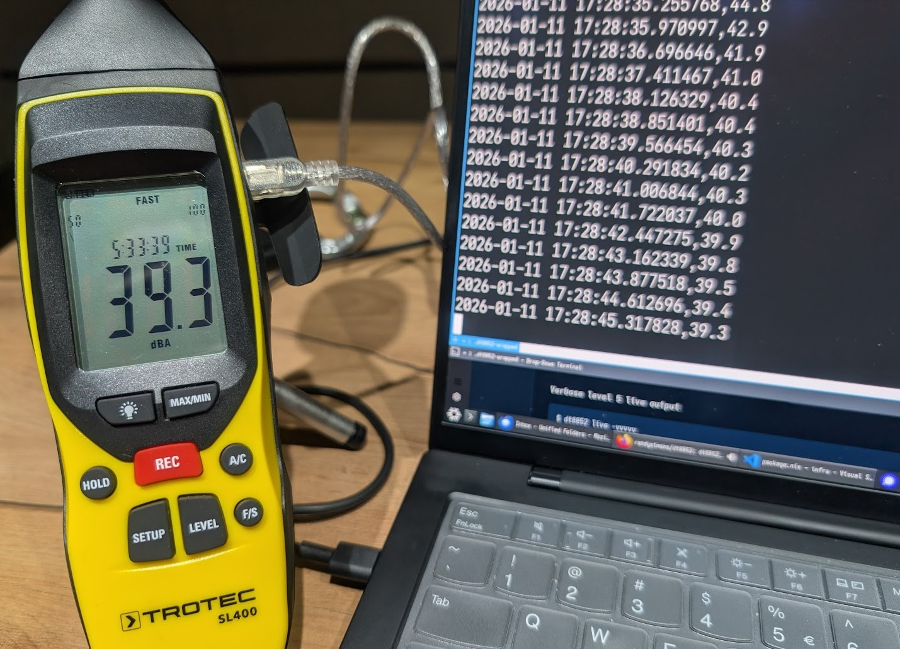

# dt8852

`dt8852` is a cross-platform Rust crate and command-line utility for the CEM DT-8852 sound level meter and compatible hardware.

This programme reads live sound pressure level (SPL) data through a USB serial connection.
It supports configuration of frequency weightings, time weightings, measurement ranges, and hold modes.



## Background

This project started in 2022 because of persistent noise disturbance caused by a commercial heat pump near my home.
I needed a simple, reliable solution to record sound levels continuously using a sound level meter connected to a
Raspberry Pi.

I did not want to depend on a Python runtime environment on an embedded device. Therefore, I decided to write my own
programme in Rust.

The programme has run continuously on the Raspberry Pi ever since, collecting objective acoustic data. Unfortunately,
the noise issue remains unresolved... but that's another story.

## Supported Devices

This programme supports sound level meters that share the same Silicon Labs CP2102 USB-to-UART bridge and serial communication protocol:

- [CEM DT-8852](http://www.cem-instruments.com/en/Product/detail/id/1294) (OEM)
- [CEM DT-8851](http://www.cem-instruments.com/en/Product/detail/id/1294) (same protocol, without internal data recording memory)
- [Trotec SL400](https://en.trotec.com/shop/sl400-sound-level-meter.html)
- [Voltcraft SL-451](https://www.conrad.com/en/p/voltcraft-sl-451-sound-level-meter-and-data-logger-31-5-hz-8-khz-105031.html)
- ATP SL-8852
- ... and various other rebranded variants.

> [!NOTE]
> Switch on the meter and press the **Setup** button once.
> The meter must show the PC connection symbol on its display before communication can start.

## Features

- **Cross-platform**: Runs on Linux, macOS, and Windows.
- **Automatic port detection**: Automatically locates connected USB sound level meters.
- **Live SPL streaming**: Read live sound pressure level values in decibels (dB).
- **Flexible output formats**: Export measurements in plain text, JSON, or Telegraf/InfluxDB line protocol.
- **Full device configuration**:
  - Frequency weighting (dBA and dBC).
  - Time weighting (Fast and Slow).
  - Measurement ranges (30–80 dB, 50–100 dB, 80–130 dB, and Auto 30–130 dB).
  - Hold modes (Live, Maximum, and Minimum).
  - Internal recording toggle.
- **Library & CLI**: Can be used as a standalone command-line tool or integrated as a Rust crate.

## Installation

### From crates.io

```bash
cargo install dt8852
```

### From Source

Clone the repository and build or install locally using Cargo:

```bash
git clone https://github.com/drupol/dt8852.git
cd dt8852
cargo install --path .
```

Or build a release binary:

```bash
cargo build --release
```

The compiled binary will be located at `target/release/dt8852`.

## Device Drivers & Permissions

The meter communicates through an internal Silicon Labs CP2102 USB-to-UART bridge. Depending on your operating system, driver or permission configuration may be required:

### Linux

The kernel driver (`cp210x`) is included in modern Linux distributions, so no extra driver is needed. However, user permissions are required to access serial devices.

Add your user account to the `dialout` group:

```bash
sudo usermod -aG dialout "$USER"
```

Log out and log back in to apply the change.

Alternatively, install the provided udev rule:

```bash
sudo cp udev/99-dt8852.rules /etc/udev/rules.d/
sudo udevadm control --reload-rules
sudo udevadm trigger
```

### Windows

Windows 10 and 11 usually detect the device and install the required driver automatically. If needed, the driver can be downloaded directly from [Silicon Labs CP210x VCP Drivers](https://www.silabs.com/developers/usb-to-uart-bridge-vcp-drivers).

The device typically appears as `COM3` (or higher COM port).

### macOS

If not automatically detected, install the Virtual COM Port (VCP) driver from [Silicon Labs CP210x VCP Drivers](https://www.silabs.com/developers/usb-to-uart-bridge-vcp-drivers).

The device typically appears as `/dev/cu.usbserial-*` or `/dev/tty.usbserial-*`.

## Usage

The CLI automatically detects connected meters. You can also specify a port explicitly with `--serial-port <PORT>` (e.g. `--serial-port /dev/ttyUSB0` or `--serial-port COM3`).

```bash
dt8852 [OPTIONS] <COMMAND>
```

### 1. Identify Connected Ports

List all available serial ports and detect connected CP2102 devices:

```bash
dt8852 list-ports
```

Example output:

```text
Port                 Details
-------------------- ----------------------------------------
/dev/ttyUSB0         CP2102 USB to UART Bridge Controller [VID: 10c4, PID: ea60]
```

### 2. Stream Live Measurements

Stream live decibel readings (using automatic port detection):

```bash
dt8852 live
```

Or specify the serial port manually:

```bash
dt8852 --serial-port /dev/ttyUSB0 live
```

#### Verbosity Levels

Use the `-v` flag to increase verbosity:

- **Default (no flag)**: SPL values only (e.g. `45.2`)
- **`-v`**: Timestamp and SPL (e.g. `2026-11-11 19:49:42.806,45.2`)
- **`-vv`**: SPL per token received
- **`-vvv`**: Timestamp and SPL per token
- **`-vvvv`**: Raw decoded protocol tokens for debugging

```bash
dt8852 live -v
```

#### Output Formats

Stream measurements formatted as JSON:

```bash
dt8852 live --format json
```

Stream measurements formatted for Telegraf / InfluxDB line protocol:

```bash
dt8852 live --format telegraf
```

Example Telegraf output:

```text
dt8852,frequency_weighting=dB(A),time_weighting=Fast,range_mode=30dB\ -\ 130dB\ auto\ range,hold_mode=Live spl=45.2
```

### 3. Display Current Device Configuration

Query the current device settings and status:

```bash
dt8852 get-mode
```

Example output:

```text
current_time = 21:20:30
current_spl = 42.1 dB
frequency_weighting = dBA
time_weighting = Fast
range_mode = 30-130 dB (Auto)
hold_mode = Live
recording_mode = Not Recording
```

Output configuration formatted as JSON:

```bash
dt8852 get-mode --format json
```

### 4. Configure Device Parameters

Reconfigure measurement parameters:

```bash
# Set dBA frequency weighting and Slow time weighting
dt8852 set-mode --freqweighting dba --timeweighting slow

# Set 30–80 dB range with Max hold mode
dt8852 set-mode --range R_30_80 --hold max

# Start or stop internal data recording
dt8852 set-mode --record recording
dt8852 set-mode --record not-recording
```

Available parameters:

- `--freqweighting`: `dba`, `dbc`
- `--timeweighting`: `fast`, `slow`
- `--range`: `R_30_80`, `R_50_100`, `R_80_130`, `R_30_130_AUTO`
- `--hold`: `live`, `min`, `max`
- `--record`: `recording`, `not-recording`

## Troubleshooting

### The Clock Problem

Besides the 9V battery, these meters contain an internal lithium coin cell to keep the real-time clock running when powered off. When this cell runs out, the clock stops or resets to `00:00:00`.

You can replace the lithium cell (typically CR1220) by opening the device casing.

After replacing the cell, if the clock is still frozen:

1. Power on the device while holding down the **Setup** button.
2. Repeatedly press **Setup** until `rSt` is displayed.
3. Press **HOLD**.

The device will reset its internal date and time.

## Rust Library Usage

Add `dt8852` and `serialport` to your `Cargo.toml`:

```toml
[dependencies]
dt8852 = "0.9"
serialport = "4.8"
```

Example code:

```rust
use dt8852::{Dt8852, Token};
use std::time::Duration;

fn main() -> Result<(), Box<dyn std::error::Error>> {
    let port = serialport::new("/dev/ttyUSB0", 9600)
        .timeout(Duration::from_millis(5000))
        .open()?;

    let mut meter = Dt8852::new(port)?;

    loop {
        if let Some((token, _changed)) = meter.decode_next_token(true)? {
            if let Token::CurrentSpl(spl) = token {
                println!("Sound Level: {:.1} dB", spl);
            }
        }
    }
}
```

## Running Tests

Run the test suite:

```bash
cargo test
```

Run linter checks:

```bash
cargo clippy -- -D warnings
```

Verify formatting:

```bash
cargo fmt --check
```

## Acknowledgements & References

- Original Python [`dt8852`](https://codeberg.org/randysimons/dt8852) package by **Randy Simons**.
- Protocol and hardware details documented on the [Sigrok CEM DT-8852 wiki](https://sigrok.org/wiki/CEM_DT-8852).

## Licence

This project is licensed under the MIT Licence.
See the [LICENSE](LICENSE) file for details.
